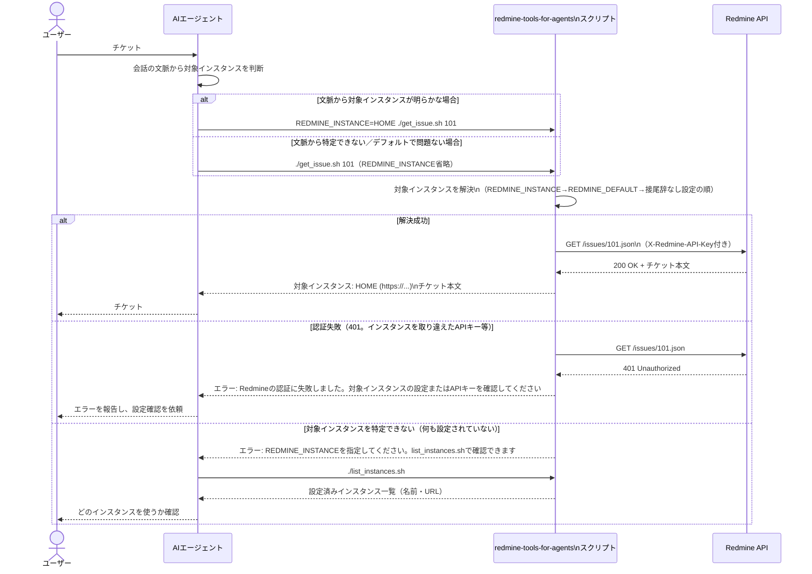
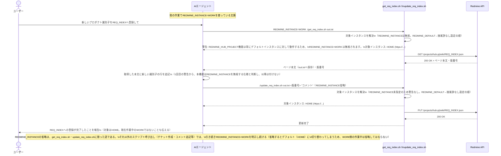

# 複数Redmineインスタンス対応のシーケンス

複数のRedmineインスタンスを設定している場合に、AIエージェントが本スキルのスクリプトを
どのような流れで呼び出すかを示す。設定方法・各スクリプトの詳細な使い方は
[`SKILL.md`](../SKILL.md)の「複数のRedmineインスタンスを扱う場合」、
セットアップ手順は[`setup.md`](setup.md)を参照。

## 通常のスクリプト呼び出し

対象インスタンスは、呼び出し時に`REDMINE_INSTANCE=<NAME>`を前置して指定する。省略した場合は
`REDMINE_DEFAULT`、次に接尾辞なしの`REDMINE_URL` / `REDMINE_API_KEY`の順でデフォルトインスタンス
が使われる。どちらも無ければエラーになる。

## REDMINE_HUB_PROJECT・REDMINE_REQ_INDEX_PAGEを扱う場合

プロダクト識別子（プレフィックス）一覧機能（`get_req_index.sh` / `update_req_index.sh`）は、
複数インスタンス対応後も常にデフォルトインスタンスのみを対象とする。`REDMINE_INSTANCE`を
指定しても無視され（指定していれば、無視される旨の警告が表示される）、他インスタンスへ
切り替えることはできない。

